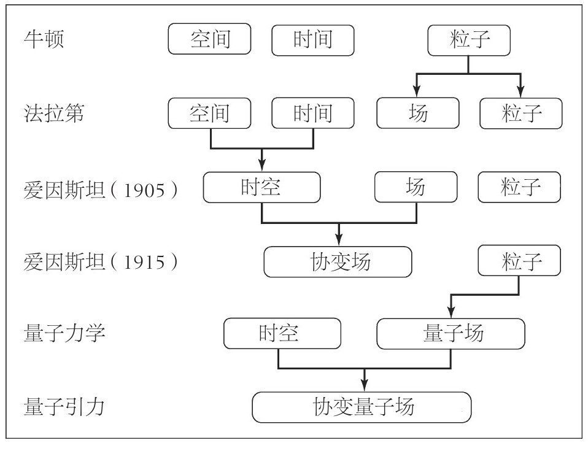

#+TITLE: 物理学里的软件工程 - 《现实不似你所见》
* 物理学是一个逆向抽象工程
#+begin_quote

粒子是量子场的量子； 光由场的量子形成； 空间也只不过是由量子构成的场； 时间也在这个场的过程中形成。 换句话说， *世界完全由量子场构成*

#+end_quote

《现实不似你所见》这本书带我们走过了物理学发展历史中最重要的几座里程碑。 从自由落体定律到牛顿力学，再到相对论、量子力学，最后到圈量子引力理论，这些理论的发展被完美地整理到了一张树状图中：

而我却下意识地把这张图和 UML 的类图对应了起来： 如果把这一个个物理概念对应为一个个 class，那这幅图呈现的就是他们之间的继承关系：

- 「时空」和「场」是「协变场」的 *子类*
- 「场」和「粒子」是「量子场」的 *子类*
- 「时空」和「量子场」是「协变量子场」的 *子类*

#+begin_quote

*我们能够创造的对世界的描述正在变得愈发精练而简单。*

#+end_quote

对大一统理论的追求，是为了用最简单、最抽象的规则来解释这个世界。 物理学的探索过程，在我看来就是「对世界的一次逆向工程」。

- 这个世界是否存在这么一个基类 Object ，所有的粒子、物质都继承自这个基类呢？
- 如果找到了这个最简单的规则，最基础的基类，那我们是不是就能用程序模拟出这个世界？

我们还不知道这些问题的答案，但是只要人类继续存续下去，这个「逆向工程」就永远不会停止。

* 从「过程」的角度思考世界
#+begin_quote

- 速度不是物体本身的属性，它是一个物体相对于另一物体运动的属性。

  - 爱因斯坦把相对性的概念拓展到了时间： 只有相对于某一特定的运动，我们才能说两个事件是同时的。
  - 量子力学以一种根本的方式扩展了相对性： 一个物体的所有变量都只相对于其他物体而存在。 *自然只是在相互作用中描绘世界。*

- 量子力学描述的不是物体： 它描述的是过程，以及过程之间连接点的事件。
- 量子力学教会我们， 不要以处在某一状态的“物体”的角度来思考世界，而应该从“过程”的角度来思考。

#+end_quote

再次将这些理论和面向对象编程做对比：

- [[http://userpage.fu-berlin.de/~ram/pub/pub_jf47ht81Ht/doc_kay_oop_en]["Messaging" is the key]]
- 一个对象自身有哪些属性其实并不重要，重要的是它和其他对象相互作用时的表现。

* 如何在多变的环境中生存？
#+begin_quote

在一个多变的环境中持续生存的有效方式就是与外在世界维持更好的关联，其关键就是信息——去收集、存储、传递、精练信息。

#+end_quote

- 产品研发也是在一个多变的环境中持续进行的，因此， *闭门造车是无法做出好产品的。*

  - 只有不断地和「外在世界」（用户、社区、依赖……）维持更好的关联，产品才能越做越好。
  - 而维持关联的方式就是构造更好的反馈闭环： 不断地收集信息、消化信息，并将各方面的信息应用到产品上。

- 我们应用运行的生产环境也是一个多变的环境，因此， *打造高可用的服务、应用、对象、函数，也都需要让它们与它们所在的环境维持更好的关联。*

  - Logger 是收集、存储应用报错信息的有效手段，但是不够及时、有效。
  - 更有效的手段可能是在错误发生的当下就将信息传递出去，并及时精练、处理。 （[[https://yiming.dev/clipping/2019/09/04/3-key-ideas-behind-the-erlang-thesis/][这也正是 Erlang/OTP 的 Supervision Tree 背后的思路]]）

* 世界是离散的
#+begin_quote

- 为无穷设定限度在现代物理学中是个反复出现的主题。

  - 狭义相对论也许可以总结为发现了一切物理系统都存在一个最大速度光速 c
  - 量子力学可以总结为发现了每个物理系统都存在信息的最大值。普朗克常数 h
  - 量子引力 -> 最小的长度普朗克长度 Lp

- 这三个基本常数的确定为自然看似无穷的可能性设置了限度，这表明 *我们称之为无穷的东西只不过是我们尚未计算或理解的内容。*

  - “无穷”根本上是我们给予尚未了解之物的名字。
  - 自然似乎在告诉我们，没有什么是真正无穷的。

#+end_quote

- 如果世界是分立的（离散的），那么我们能否用计算机（数字信号）来模拟一个世界呢？
- 如果以后的内存容量足够大，大到能储存这个宇宙所有粒子的状态，那么我们能否创造一个一模一样的世界呢？
- 反过来思考的话，现在我面前 16GB 的内存里储存着的，是否也是一个微型的世界呢？

P.S. 这样的思路让我想起了《三体》中的降维打击：光速原本是无限大的，只是在一次次的降维打击中逐渐减速，降低到了现在的这个值。 也许「无穷」还是存在的，只是存在于更高维度的世界里罢了。

* 时间的消逝
#+begin_quote

- 时间不是我们想的那样

  - 我们不能把时间看作一个记录宇宙生命的巨大宇宙时钟
  - 我们应该把时间看成局部的现象：

    - 宇宙中的每个物体都有它自己的时间之流，其速度由当地的引力场决定。
    - 但是当我们把引力场的量子特性考虑进来的时候，即使是局部时间的概念也不再起作用。

      - 在普朗克尺度上，量子事件不再按照时间的流逝先后发生。
      - 在某种意义上，时间不再存在。

        - 首先，时间变量从基本方程中消失并不意味着一切都是静止的，不表示改变不会发生。
        - 刚好相反，这表明 *变化是普遍存在的。* 这只是表明：基本过程不再能够被形容为“一个瞬间接着另一个瞬间”。
        - 每个物理过程都遵循着自己的节奏，独立于邻近的其他过程。时间的流逝是世界所固有的，是世界与生俱来的，从量子事件之间的关系中产生。这些量子事件正是世界本身，产生它们自己的时间。

- 时间变量的存在是个有用的假设，并不是观测的结果

  - 我们必须学会不以事物在时间中变化而是以其他方式来思考世界。
  - *事物只是相对于另一事物发生变化。*

#+end_quote

在分布式系统中，如何统一各个子系统的时钟是一个核心问题。 但是，有没有可能这个思路从一开始就错了呢？ 如果世界本身并没有一个统一的时钟，那为什么我们的分布式系统需要呢？ 也许，我们并不需要时间这个概念来思考世界，只需要考虑事物（子系统）之间的变化。 (Actor Model)

* 可检验的预测是强有力的工具
#+begin_quote

- *可检验的预测是强有力的工具，可以让我们在误解某些事情时及时地发现问题*
- 缺少实验证据的理论是还没通过检验的理论
- 检验永不会结束，一个理论不会因为一个、两个或三个实验就被彻底证实，但随着它的预言被证明为真，理论的可信度会逐步增加。

#+end_quote

以前我以为写代码、做产品更像是艺术（art），而不是科学（Science）。 但现在，我认为软件开发应该是一门科学，应该遵循系统的方法。

*可检验的预测* 便是「科学在软件开发中应用」的一个很好的例子：

1. 在写完一个测试后问一问自己：「这个测试能通过吗？如果不能，为什么不能通过？」 然后用这个预测和测试结果进行比对。 这样，无论是我们预测能够通过的测试失败了，还是我们预测不能通过的测试通过了，都说明我们的理解有误。 而尽早地发现这些问题，能避免这些问题被不断放大，以较低的成本修复他们。
2. 开发一个功能、产品时，都把它背后的假设写下来，并考虑如何检验这个假设。 [[https://yiming.dev/blog/2019/05/16/defining-a-mvp-by-setting-okrs/][Defining a MVP by Setting OKRs]] 而且「检验永不会结束」，一个功能只有经受过无数次大风大浪的检验，才能进化成型。

* 今天的无知可以被明天照亮
#+begin_quote

- 重要的不是假设我们通晓一切，而是相反：

  - *意识到昨天的无知可能被今天阐明，今天的无知可以被明天照亮。*
  - 要点在于对放弃求知欲的反抗： 宣告我们相信世界是可以被理解的， 骄傲地回击那些满足于自己无知的人，那些把我们不了解之事称为无限、把知识置于他处的人。
  - *唯一真正无限的是我们的无知*

- 意识到我们知识的局限也就是意识到我们所了解的也许会是错误的或不准确的。

  - 只有记住我们的信念有可能是错的，才有可能把我们从错误的概念中解放，并且学习到正确的观念。
  - 要学习某件事，必须要有勇气接受我们自认为知道的，即使最根深蒂固的信念都有可能是错的，或至少是不成熟的：只不过是柏拉图洞穴墙上的影子。

- 科学家是深刻意识到我们的无知、直接接触我们自身的无数局限与理解上的局限的人。

  - *科学是目前为止关于我们所面对的问题的最大已知。* 恰恰是因其开放性，因其不停对当前知识提出疑问，才保证了它所提供的答案是目前为止最好的： 如果你找到了更好的答案，这些新答案就变成了科学。
  - 科学就是对已有的最可信答案的寻求，而不是对自称确定无疑的答案的寻求。

#+end_quote

被求知欲驱使不断探索； 与此同时，又保持着一颗谦逊的心； 这大概就是[[http://dsdshcym.github.io/blog/2017/12/05/meaning-of-life/][人生的意义]]吧。

用一句我最喜欢的谚语做结尾，与你共勉：

#+begin_quote

The only thing I know, is that I know nothing.

#+end_quote
